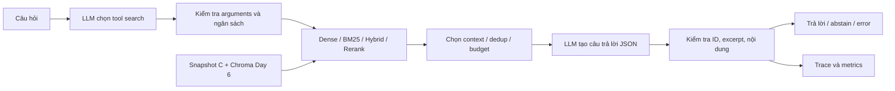

# Kiến trúc

- `src/settings.py`: đường dẫn có thể cấu hình; đọc .env Day 7 trước, Day 6 sau.
- `src/pipeline.py`: chỉ nhận query, mode, top-k; giữ ID/provenance Day 6. BM25 dùng
  token Unicode NFC có dấu; không có word segmenter tiếng Việt.
- `src/retrieval.py`: BM25 minh bạch, hợp nhất theo rank bằng RRF k=60.
- `src/tool_agent.py`: model OpenAI phát ra function call, chương trình thực thi
  search rồi gửi role=tool trở lại model. Benchmark controlled dùng đúng query gốc,
  top-3 và một mode cố định. Demo có thể cho phép tối đa hai lượt tìm.
- `src/agent.py`: validator/normalizer dùng chung; lớp generation cố định giữ để
  tái đọc các trace chẩn đoán trước đây, không gắn nhãn chúng là tool calling.
- `src/context.py`: budget 6.000 ký tự; chunk không vừa bị bỏ toàn bộ, ghi dropped IDs.
  Đếm token thực tế trong trace bằng cl100k_base; không cắt giữa các ngoại lệ.
- `src/api.py` + `web/`: FastAPI localhost, không nhận đường dẫn file từ client,
  chặn cross-origin và query quá dài; toàn bộ nội dung động được render bằng textContent.
- `src/evaluation.py`: mẫu số tách riêng answerable/insufficient, review theo run+case,
  metrics không có nhãn thủ công trả N/A thay vì ngầm chấm 0.

Model vẫn có thể trả lời sai dù ID và quote hợp lệ. Semantic support phải được
đối chiếu nguồn. Trường `estimated_chat_cost_usd` dùng token thực tế và bảng giá
tham khảo; `actual_chat_cost_usd=null` vì API không báo hóa đơn.

Tool schemas và giới hạn tuân theo [OpenAI function calling](https://developers.openai.com/api/docs/guides/function-calling).
Bảng giá được tra ngày 2026-11-14 ở [model GPT-4o mini](https://developers.openai.com/api/docs/models/gpt-4o-mini).
Model không tự đổi khi bị lỗi hoặc bị ngừng cung cấp.
